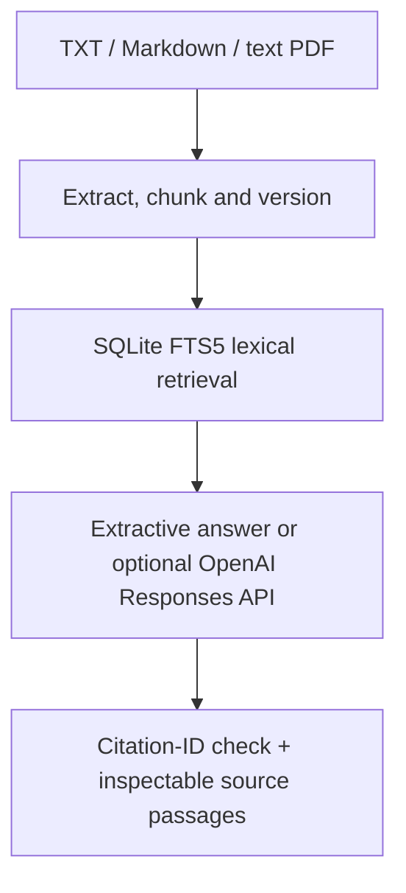

# FieldWise RAG Assistant

A fresh public reference implementation of a cited engineering-document assistant. It ingests documents, versions their contents, retrieves relevant passages and provides either local extractive answers or optional OpenAI-generated responses.

**Provenance:** independently recreated in October 2026, inspired by the high-level [Beyond Human FieldWise case study](https://beyondhuman.dev/case-study/fieldwise/). This repository is newly written demonstration code, not that deployment's source. All bundled documents are fictional. The case study's page count and business outcome figures are not benchmark claims for this implementation.

## Run locally without a key

Requires Python 3.11+ with SQLite FTS5.

```bash
python -m venv .venv
. .venv/bin/activate
python -m pip install -e '.[test]'
fieldwise ingest sample_docs/*.md
fieldwise serve
```

Open http://127.0.0.1:8001. Ask about the Pump Alpha amber indicator, the Conveyor Beta blue sensor, or the fictional document-control policy. Answers show exact passages, page numbers and content versions.

The default extractive mode quotes retrieved text. It does not call an LLM or require network access.

## Data flow



| Component | What it demonstrates |
|---|---|
| retrieval.py | Transactional ingestion, replacement/deduplication, chunk/page provenance |
| answers.py | Evidence-first answering, abstention, server-side API adapter, citation checks |
| app.py | Bounded local HTTP API and single-user browser workbench |
| evaluate.py | Synthetic retrieval and abstention regression evaluation |
| sample_docs/ | Explicitly fictional engineering documents |

## Optional OpenAI mode

Set OPENAI_API_KEY and OPENAI_MODEL in the **server environment**, then set FIELDWISE_PROVIDER=openai before starting the server. Choose a Responses-compatible text model available to your account. The application never embeds the key in frontend assets, stores it in the index or returns it in responses.

Only the question and selected passages are sent to OpenAI. This is an opt-in data transfer; use synthetic or approved material. The request uses store=false, which is not a claim of zero data retention or a replacement for your account's data policy. The default local mode makes no API calls.

Citation validation rejects missing or unknown citation IDs. It **does not prove factual entailment or eliminate prompt injection/hallucinations**. Human review and adversarial evaluation are still required.

## Ingestion and retrieval contract

- Browser: UTF-8 TXT/Markdown under 200 KB. CLI: TXT/Markdown or text-based PDF under 5 MiB (install the pdf extra for PyMuPDF).
- No OCR, URL crawler, scanned-PDF recovery or model-based embeddings.
- SQLite BM25 retrieval with tokenized/quoted queries; a simple lexical coverage threshold can abstain on unknown questions.
- Up to 100 documents and 500 pages/document; extracted text capped at two million characters/document. Documents sharing a filename replace the previous searchable version atomically.
- A SHA-256 content version records the indexed page text. PDF citations use extracted page numbers; text/Markdown uses page 1.
- Lexical retrieval can miss synonyms, multilingual terms and complex questions. This is intentionally a transparent baseline, not a claim of semantic-vector search.

## Tests and evaluation

```bash
python -m pytest -q
python -m fieldwise.evaluate
fieldwise ask "What does the Pump Alpha amber indicator mean?"
```

The tests cover version replacement, deduplication, rollback on invalid content, safe query syntax, abstention, invalid model citations, mocked OpenAI payload/response handling and API boundaries. The eight-case synthetic evaluation measures retrieval/abstention only.

Live OpenAI answers have **not been exercised** during this build; no API key was used. No production corpus, answer-accuracy, cost or throughput result is claimed.

See [architecture](docs/architecture.md) and [security/deployment scope](SECURITY.md).

## Primary references

- [SQLite FTS5 / BM25](https://www.sqlite.org/fts5.html)
- [OpenAI text generation](https://developers.openai.com/api/docs/guides/text)
- [FastAPI](https://fastapi.tiangolo.com/)
